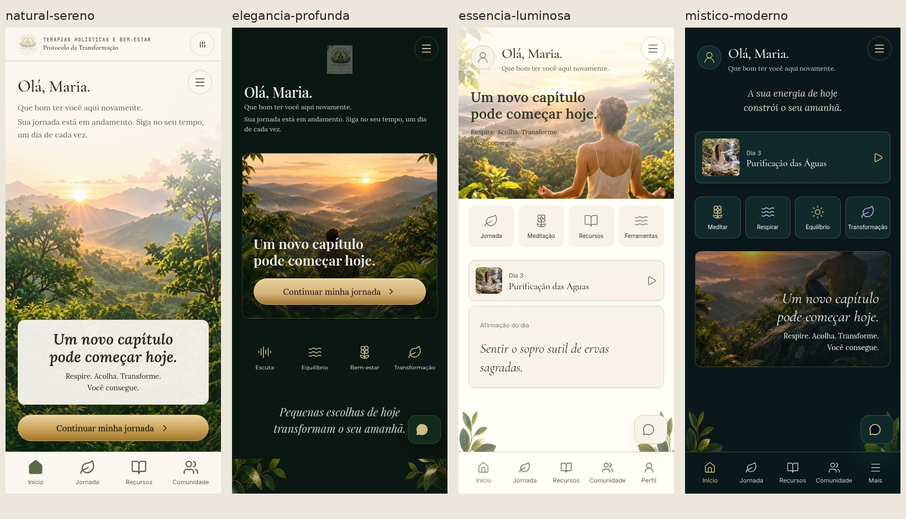

# Quatro referências visuais

Esta pasta registra a comparação dos quatro modelos com a implementação da branch de restauração.

**Status: em revisão; igualdade integral aos modelos ainda não certificada.**

| Estilo | Modelo e telas do aplicativo | Comparação focada da Home |
| --- | --- | --- |
| Natural Sereno | [Comparação completa](natural-sereno-comparison.jpg) | [Home](natural-sereno-home-focus.jpg) |
| Elegância Profunda | [Comparação completa](elegancia-profunda-comparison.jpg) | [Home](elegancia-profunda-home-focus.jpg) |
| Essência Luminosa | [Comparação completa](essencia-luminosa-comparison.jpg) | [Home](essencia-luminosa-home-focus.jpg) |
| Místico Moderno | [Comparação completa](mistico-moderno-comparison.jpg) | [Home](mistico-moderno-home-focus.jpg) |

O primeiro espaço da comparação identifica o splash não reproduzido, em vez de substituir essa tela por uma captura de outro estado.

Fontes visuais originais: `public/brand/*/prancha-modelo.jpg`. Os cenários usados nas telas dos estilos 2–4 são reconstruções, não fotografias originais extraídas das pranchas. Dados da conta e conteúdo demonstrativo da referência não são equivalentes.

Resultados de navegação e medidas em [verification.json](verification.json). Critérios, achados abertos e limites em [design-qa.md](../../../design-qa.md).
